<picture>
  <source media="(prefers-color-scheme: dark)" srcset="assets/hero-dark.svg">
  
</picture>

<p>
  <a href="https://doi.org/10.5281/zenodo.24358099"></a>
  
  
  
</p>

Built for [Brush](https://brushaway.app), open for anyone.

A step-by-step way to build software with AI where people stay in charge. It works for one person holding every role, or for a team with one person per step.

AI analyses, builds and reviews. People decide, merge and test in the real world. A ticket system holds the memory, so every change leads back to a reason.

**Read the framework:** [FRAMEWORK.md](FRAMEWORK.md)
**Copy the templates:** [templates/](templates/)

## Start a project with it

The **setup kit** is a wizard that runs inside your AI tool. It does step 4 (Setup) for you, then hands your first idea to a brainstorm or a design. **You only log in, create accounts and click two installs.**

In Claude Code:

```
/plugin marketplace add Alcagoita/brush-frame
/plugin install framework-setup@brush-frame
```

Then, in your project folder, ask: **"Set up this project with Brush Frame."**

Codex and other tools: see [SETUP.md](SETUP.md).

The wizard:

1. Asks **what you are building** (web, mobile, both, backend) and how you work (solo or a team).
2. Shows the plan, runs every script with `--dry-run` first, then sets up: GitHub with `main` + `develop`, merge rules, CI with unit tests, ticket keys on every commit, Jira or GitHub Issues, AI review, secrets protection.
3. Writes or tidies the rule file (`AGENTS.md`, imported by `CLAUDE.md`) and its memory rules, with your approval for each change.
4. Suggests a few skills for what you build. Nothing is installed without a yes.
5. Asks once whether you want **Pigment** (below). Optional.
6. Runs a practice ticket through the whole loop. You say "merge".
7. Asks for your idea, puts it in a decision ticket, and opens a new chat to **talk it through** (a brand expert and a UX designer) or **start sketching**.

**Joining a project that is already set up?** Ask the same thing. The wizard sees it and only sets up your computer: the commit hook, your logins, the recommended skills.

It never sees a password, token or key, never pays or accepts terms for you, and never force-pushes or deletes. Details: [SETUP.md](SETUP.md).

## Optional: Pigment, what the work costs

[Pigment](https://github.com/Alcagoita/pigment) is a separate Claude Code mod that shows, beside the chat, what each prompt, task and session costs. **Optimize now** writes a summary of the work in progress so you can carry on in a fresh session. For a manager, it shows the sprint by task, who is working now, the time worked on each task, and which tasks are close to their estimate. It can log worked time in Jira when a task reaches Testing.

Numbers stay on your computer (a file in the project, kept out of git) or in your own Cloudflare account, which a team needs. Only numbers are stored, never prompts or code. **Nothing in Brush Frame needs it.** Say no in the wizard and it's never mentioned again.

```
/plugin marketplace add Alcagoita/pigment
/plugin install pigment@pigment
```

## The eight steps

<picture>
  <source media="(prefers-color-scheme: dark)" srcset="assets/steps-dark.svg">
  
</picture>

<details>
<summary>The steps as text</summary>

1. **Idea check:** decide whether an idea is worth building.
2. **Design:** screens, model facts and product promises.
3. **Planning:** small tickets with one clear goal each.
4. **Setup:** guardrails before the first feature.
5. **Build loop:** one ticket, one branch, one reviewed PR.
6. **Field test:** real people, real devices.
7. **Learn:** every correction becomes a rule.
8. **Release:** a tagged version with notes.

</details>

## Status

Version 0.3, draft. See the [changelog](CHANGELOG.md). Proposals for changes are welcome as issues, with the reason.

## How to cite

> Nascimento, O. (2026). *Brush Frame: a human-led way to build software with AI*. Zenodo. https://doi.org/10.5281/zenodo.24358099

This DOI always points to the latest version. Each release also has its own DOI on [Zenodo](https://doi.org/10.5281/zenodo.24358099): v0.3 is [10.5281/zenodo.24407428](https://doi.org/10.5281/zenodo.24407428), v0.2 is [10.5281/zenodo.24358100](https://doi.org/10.5281/zenodo.24358100). GitHub's "Cite this repository" button uses [CITATION.cff](CITATION.cff).

## Licence

The framework text is licensed under [CC BY 4.0](https://creativecommons.org/licenses/by/4.0/). Share and adapt it, including commercially, with credit to Olegário Nascimento. The templates in `templates/` are released under [CC0 1.0](https://creativecommons.org/publicdomain/zero/1.0/). See [LICENSE](LICENSE).
